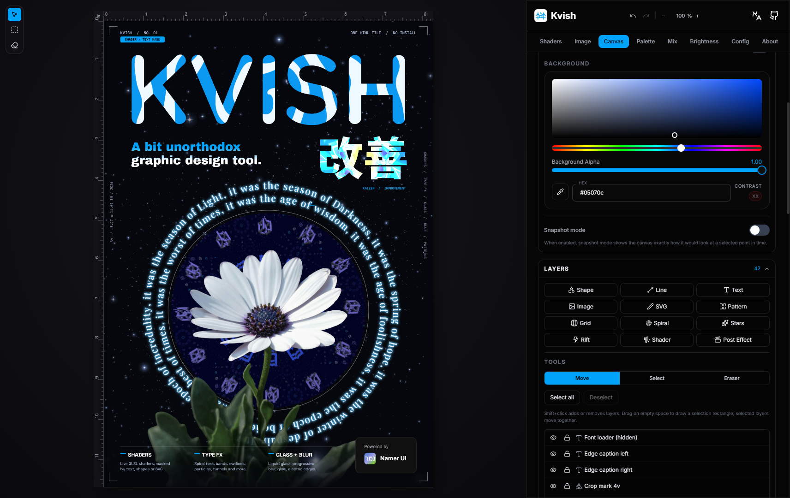

# Kvish | כביש
A bit unorthodox graphic design tool.

Link: https://kvish.netlify.app/

SourceForge page: https://sourceforge.net/projects/kvish/



Photo by [Sepehr Samavati](https://unsplash.com/@sepehrsamavati?utm_source=unsplash&utm_medium=referral&utm_content=creditCopyText) on [Unsplash](https://unsplash.com/photos/a-close-up-of-a-flower-with-a-blurry-background-pItZQNGp8dA?utm_source=unsplash&utm_medium=referral&utm_content=creditCopyText)

The app is fully localized into:

✅ English (United States)

✅ Hebrew (Israel)

✅Italian (Italy)

✅German (Hochdeutsch)

### Attribution & Shader Modification Disclosure

Attribution to the original works is present in the ```Attribution & Third-party licenses``` section on the ```About``` tab within [the app itself](https://kvish.netlify.app/).

Regarding the shaders distributed under the Creative Commons Attribution-NonCommercial-ShareAlike (CC BY-NC-SA 3.0 / CC BY-NC-SA 4.0) licenses:

These shaders have been modified, at the very least, to the extent necessary to run on Kvish, and may have been further altered to have their appearance enhanced, remixed, or changed by modifying and/or extending the shaders' logic. 
